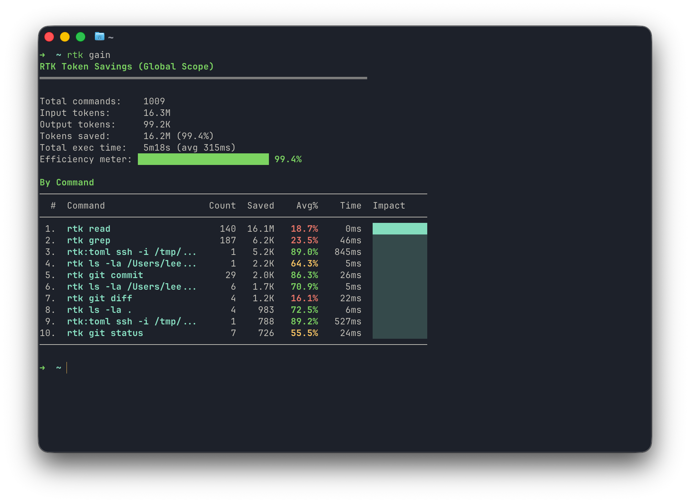

Agent 在运行命令时，会将原始输出原封不动的丢进 LLM 上下文，这些输出原本是给人在终端中看的，有很多冗余信息，比如换行、颜色转义码、分割线，这些东西在 LLM 看来就是噪声。

[rtk (Rust Token Killer)](https://github.com/rtk-ai/rtk) 会在命令输出到达 LLM 上下文之前进行过滤和压缩，它会把 Agent 准备执行的 shell 命令改写成 rtk 代理命令，
比如，本来应该执行的是 `git status`，但最终的执行会是 `rtk git status`。

## 安装

GitHub上有该工具的[中文安装教程](https://github.com/rtk-ai/rtk/blob/develop/README_zh.md)，要注意的是，安装完成后，要记得为你的 AI 工具初始化一下，
让它知道将命令代理到 rtk 上去：

```bash
# 1. Install for your AI tool
rtk init -g                     # Claude Code / Copilot (default)
rtk init -g --gemini            # Gemini CLI
rtk init -g --codex             # Codex (OpenAI)
rtk init -g --agent cursor      # Cursor
rtk init -g --agent windsurf    # Windsurf
rtk init --agent cline          # Cline / Roo Code
rtk init --agent kilocode       # Kilo Code
rtk init --agent antigravity    # Google Antigravity
rtk init --agent kimi           # Kimi AI
rtk init -g --agent pi          # Pi
rtk init --agent omp            # Oh My Pi (OMP)
rtk init --agent hermes         # Hermes
rtk init -g --agent droid       # Factory Droid

# 2. Restart your AI tool, then test
git status  # Automatically rewritten to rtk git status
```

## 看省了多少

运行 `rtk gain` 查看统计数据。



rtk 省掉的是「bash 输出」这一部分。而 bash 输出只是输入 token 的一部分，输入 token 又只是账单的一部分（还有系统提示、对话历史、输出 token）。所以 99.4% 说的是它经手的那部分被压掉了多少，不等于花费也少了 99%。
