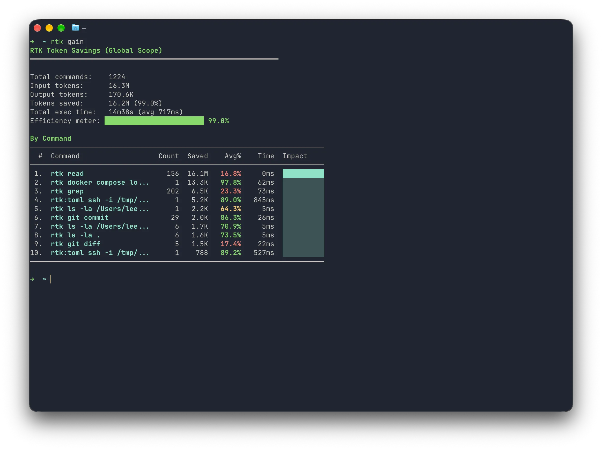

[RTK（Rust Token Killer）](https://github.com/rtk-ai/rtk)，顾名思义，就是一个用 Rust 写的 Token 杀手。作为 CLI 代理，它执行命令后会先过滤、整理输出，再把结果交给 Agent。例如，通过 `rtk git status` 执行 Git，可以让 Agent 收到更紧凑的状态信息。

下面是在同一个仓库中分别运行 `git status` 和 `rtk git status` 的结果:

```ansi
git status
On branch main
Your branch is up to date with 'origin/main'.

Changes not staged for commit:
  (use "git add <file>..." to update what will be committed)
  (use "git restore <file>..." to discard changes in working directory)
	modified:   src/content/posts/rtk-usage.mdx

no changes added to commit (use "git add" and/or "git commit -a")

rtk git status
* main...origin/main
 M src/content/posts/rtk-usage.mdx
```

RTK 保留了分支和文件状态，省去了 Git 的说明文字。

## RTK 会怎样处理命令输出

不同命令有不同的过滤规则。例如，Git diff 会减少上下文和头部信息；测试结果可以把通过项折叠成计数，集中展示失败项；搜索结果可以按文件分组，并截断过长的行。

接入后的执行过程可以这样理解：

```text
Agent 发起命令 → RTK 调用实际命令 → 命令产生原始输出 → RTK 过滤整理 → Agent 收到结果
```

因此，安装 RTK 后，还需要让 Agent 实际通过它执行命令。仅仅把二进制文件放进 PATH，并不会让所有命令自动获得压缩效果。

## 为 AI 工具初始化

项目提供了[中文安装教程](https://github.com/rtk-ai/rtk/blob/develop/README_zh.md)。完成安装后，按自己使用的 AI 工具选择对应的初始化命令：

```bash
# 1. 按使用的 AI 工具选择一条初始化命令
rtk init -g                     # Claude Code / Copilot (default)
rtk init -g --gemini            # Gemini CLI
rtk init -g --codex             # Codex (OpenAI)
rtk init -g --agent cursor      # Cursor
rtk init -g --agent windsurf    # Windsurf
rtk init --agent cline          # Cline / Roo Code
rtk init --agent kilocode       # Kilo Code
rtk init --agent antigravity    # Google Antigravity
rtk init --agent kimi           # Kimi AI
rtk init -g --agent pi          # Pi
rtk init --agent omp            # Oh My Pi (OMP)
rtk init --agent hermes         # Hermes
rtk init -g --agent droid       # Factory Droid

# 2. 重启 AI 工具，再让 Agent 执行命令，检查是否经过 RTK
git status  # 支持自动改写的集成会将其改为 rtk git status
```

这份命令清单来自上游文档，不同版本支持的集成可能有差异。如果参数不被识别，先用 `rtk init --help` 查看本机版本支持哪些选项。

接入后，可以检查 Agent 实际执行的是不是 `rtk git status`，也可以通过 `rtk gain --history` 查看最近记录。原命令依旧没有经过 RTK，就需要检查初始化配置是否被工具加载。

## 用 `rtk gain` 查看节省了多少 token

接入后，运行 `rtk gain` 就能查看命令输出压缩前后的 token 估算值，以及累计节省的数量和比例。下面是我本机的统计结果：


